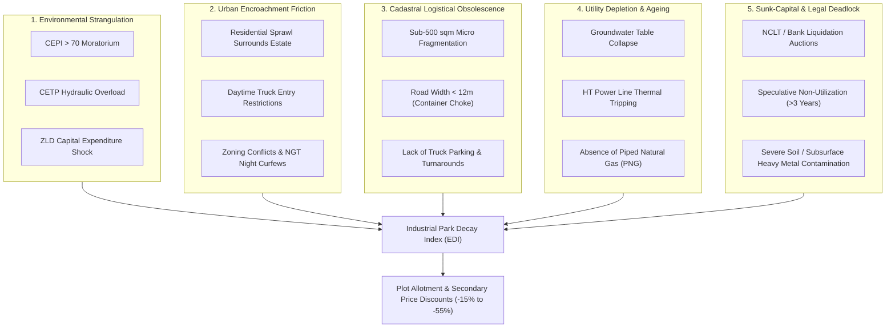
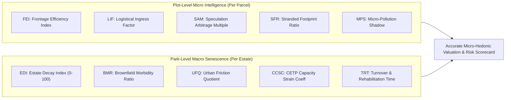
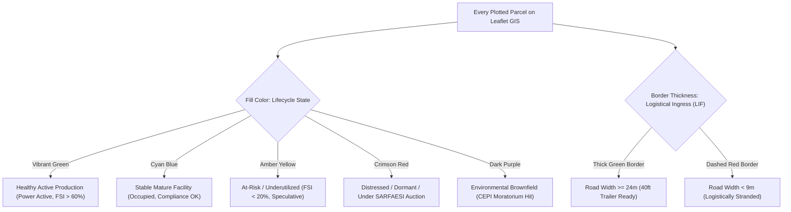
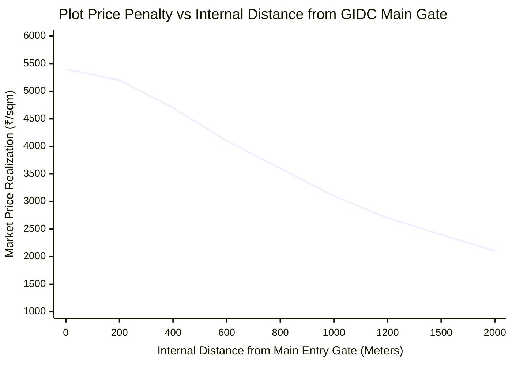
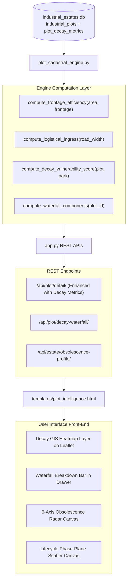

# Advanced Plot Intelligence: Micro-Metrics, Cadastral Visualisations & Industrial Lifecycle Decay Framework
**A Methodological and Architectural Blueprint for Quantifying Plot-Level Price Formation, Infrastructure Obsolescence, and Industrial Park Senescence**

---

## 1. Executive Summary & Theoretical Grounding

Traditional real estate and industrial planning frameworks operate on a naive assumption of **monotonic maturity**: that industrial parks progress smoothly from *Planning & Acquisition* $\rightarrow$ *Anchor Commissioning* $\rightarrow$ *High-Capacity Growth* $\rightarrow$ *Equilibrium Maturity*.

In reality, spatial economic history (from the US Rust Belt and the UK Midlands to older Indian industrial corridors) demonstrates that **industrial parks do not merely mature—many enter severe structural decay, technological obsolescence, and environmental morbidity**.

```
    Traditional Linear Model (Flawed):
    Acquisition ──► Anchor Influx ──► High-Capacity Ancillary ──► Permanent High-Yield Maturity
    
    Empirical Reality (Non-Linear Lifecycle with Decay Pathways):
                       ┌──► Agglomeration Expansion ──► Modernization / High-Tech Pivot
                       │
    Acquisition ──► Growth 
                       │
                       └──► Congestion / Moratorium ──► Cadastral Decay ──► Stranded Brownfield
```

In Gujarat, while newer flagship parks like **Sanand II, Dholera SIR, or Dahej PCPIR** experience dynamic growth, older generation GIDC estates established in the 1970s and 1980s (e.g., **Vatva, Odhav, Naroda, Ankleshwar Old Phases, Vapi Phase I–II, Rajkot Aji**) face complex **senescence dynamics**:
- Severe **environmental moratoriums (CPCB CEPI $>70$)** blocking expansions.
- **Cadastral fragmentation** with narrow internal roads ($<12\text{m}$) incapable of accommodating 40-foot multi-axle freight containers.
- **Urban sprawl encroachment**, where municipal residential neighborhoods surround the park, leading to night-shift curfews, vehicular entry bans, and public interest litigation (PILs).
- **Stranded brownfield plots**: Parcels tied up in debt recovery tribunals (NCLT / DRT / SARFAESI), unbuilt speculative allotments, or abandoned chemical sheds with heavy soil contamination.

This framework outlines the **advanced metrics**, **cadastral data visualisations**, and **econometric models** required to transform [`/plot-intelligence`](http://127.0.0.1:5000/plot-intelligence) into an institutional-grade platform capable of diagnosing both **capitalization premiums** and **decay risks**.

---

## 2. The 5 Archetypes of Industrial Park Decay

To model decay at the plot and park level, we categorize industrial senescence into five distinct empirical archetypes observed across Gujarat’s 312 estates:



### Archetype 1: Environmental / Regulatory Strangulation Decay
- **Manifestation**: Central Pollution Control Board (CPCB) designates the cluster as a Critically Polluted Area (CEPI $> 70$). A statutory moratorium is slapped on new environmental clearances (EC). Existing Common Effluent Treatment Plants (CETPs) exceed biological oxygen demand (BOD) and chemical oxygen demand (COD) discharge thresholds.
- **Economic Impact on Plots**: Expansion bans prevent existing units from upgrading capacity. Plot demand drops; secondary market liquidity dries up; units are forced to adopt Zero Liquid Discharge (ZLD) plants with capital expenditures exceeding the underlying land value.
- **Typical Clusters**: Old Ankleshwar Chemical Estate, Vatva Phase I, Vapi Paper & Chemical Clusters.

### Archetype 2: Urban Encroachment & Gentrification Friction
- **Manifestation**: Cities expand outward, completely enveloping peripheral estates into dense municipal urban limits.
- **Economic Impact on Plots**:
  - Municipal traffic police enforce daytime entry bans on multi-axle freight trucks (e.g., restricted movement between 08:00 and 22:00).
  - Residential neighbors file air/noise pollution PILs before the National Green Tribunal (NGT), forcing units to halt 3rd-shift (night) production.
  - High land value creates pressure for unauthorized commercial godown conversions, generating severe intra-estate congestion.
- **Typical Clusters**: Odhav & Naroda (Ahmedabad municipal perimeter), Rajkot Bhaktinagar.

### Archetype 3: Cadastral Logistical Obsolescence
- **Manifestation**: Estates platted in the 1970s and 1980s were designed for light engineering MSMEs using small 2-axle commercial vehicles (Tata 407s). Roads are $7.5\text{m}$ to $12\text{m}$ wide with acute 90-degree turning radii.
- **Economic Impact on Plots**: Modern 40-foot shipping containers and 32-foot multi-axle trailers cannot enter the internal lanes. Plots on interior cul-de-sacs experience severe functional obsolescence, trading at a $25\% - 40\%$ discount to entrance plots.
- **Typical Clusters**: Jamnagar Brass Parts Cluster (MP Shah), Bhavnagar MSME Estate.

### Archetype 4: Utility Depletion & Infrastructure Starvation
- **Manifestation**: 40-year-old underground water supply pipelines corrode; groundwater tables collapse below $200\text{ meters}$; power sub-stations face frequent thermal tripping during peak summer loads.
- **Economic Impact on Plots**: Operating expenditures escalate as units must buy private tanker water and operate diesel generators. New high-tech investments avoid the cluster.

### Archetype 5: Sunk-Capital Lock-in & Speculative Deadlock
- **Manifestation**: Plots allotted during initial expansion remain unbuilt past GIDC's mandatory 3-year construction deadline because original allottees hold them for speculative capital gains. Meanwhile, sick or closed units enter lengthy insolvency proceedings under NCLT/DRT.
- **Economic Impact on Plots**: Incomplete occupancy ruins street security, allows unauthorized waste dumping, discourages tier-1 suppliers, and creates visual blights that suppress adjacent plot valuations.

---

## 3. Advanced Metric Suite: Micro (Plot) & Macro (Park)

To provide actionable intelligence, we define two tiers of quantitative metrics:



---

### A. Plot-Level Micro Metrics

#### 1. Frontage Efficiency Index ($FEI$)
Measures whether a plot has an optimal shape or is an inefficient, deep "pencil plot":
$$FEI_i = \frac{\text{Frontage Length (meters)}}{\sqrt{\text{Plot Area (sqm)}}}$$
- **$FEI \ge 0.8$**: Optimal square/wide rectangular parcel. Allows dual loading docks, separate passenger/truck gates, and efficient turning pockets.
- **$0.5 \le FEI < 0.8$**: Standard industrial rectangular lot ($1:2$ or $1:3$ ratio).
- **$FEI < 0.5$**: Acute "pencil plot" ($>1:4$ ratio). Severe internal maneuvering bottlenecks; penalizes plot value by $-12\% \text{ to } -18\%$.

#### 2. Logistical Ingress Factor ($LIF$)
Calculates the capacity of the road fronting the plot to support modern logistics:
$$LIF_i = \frac{\text{Fronting Road Width (meters)}}{\text{Required Turning Swept Path for 40ft Trailer (15.5 meters)}}$$
- **$LIF \ge 1.5$ (Road $\ge 24\text{m}$)**: Prime multilane logistics boulevard. Eligible for multi-modal warehousing, container depots, and mega-OEM supply.
- **$1.0 \le LIF < 1.5$ (Road $15\text{--}24\text{m}$)**: Standard container-accessible arterial.
- **$0.6 \le LIF < 1.0$ (Road $9\text{--}15\text{m}$)**: Restricted access; 40ft containers must park on the road, blocking traffic during loading.
- **$LIF < 0.6$ (Road $< 9\text{m}$)**: Logistically obsolete. Cannot service heavy transport; restricted to local 3-wheelers / small pick-up trucks.

#### 3. Speculation Arbitrage Multiple ($SAM$)
Measures the disconnect between the official statutory allotment rate and open market reality:
$$SAM_i = \frac{\text{Secondary Market Asking / Auction Clearing Price (₹/sqm)}}{\text{Official GIDC Statutory Allotment Rate (₹/sqm)}}$$
- **$SAM > 2.5$**: Extreme speculative arbitrage and artificial shortage. High rent-seeking; indicates real demand far outstripping GIDC administrative release.
- **$1.0 \le SAM \le 2.5$**: Healthy agglomeration premium.
- **$0.7 \le SAM < 1.0$**: Stagnant park. Secondary sellers willing to discount below official rate due to low liquidity.
- **$SAM < 0.7$**: Severe distress / brownfield collapse. Investors cannot liquidate even at a 30% discount to statutory rates.

#### 4. Stranded Footprint Ratio ($SFR$)
Measures non-productive land utilization on the parcel:
$$SFR_i = 1.0 - \left(\frac{\text{Actual Built-up Area (sqm)}}{\text{Permissible FSI} \times \text{Plot Area (sqm)}}\right)$$
- Tracks parcels where sheds are abandoned, partially demolished, or left as vacant scrubland past statutory development windows.

#### 5. Micro-Pollution Shadow Penalty ($MPSP$)
Computes the spatial exposure of a plot to undesirable noxious environmental sources within the estate:
$$MPSP_i = \sum_{k \in \text{Pollution Nodes}} \frac{\text{Toxicity Weight}_k}{\left(\text{Distance}(i, k) + 0.1\right)^2}$$
- Evaluates proximity to:
  1. Solid hazardous waste TSDF dumping cells.
  2. CETP open biological aeration ponds (odor and vapor drift).
  3. Chemical incinerator stacks and open effluent channels.

---

### B. Park-Level Macro Decay Metrics

#### 1. Estate Decay Index ($EDI$)
A composite index ranging from $0$ (Pristine, Modern) to $100$ (Terminal Decay):
$$EDI = 0.25 \cdot S_{\text{env}} + 0.25 \cdot S_{\text{cadastral}} + 0.20 \cdot S_{\text{morbidity}} + 0.15 \cdot S_{\text{urban}} + 0.15 \cdot S_{\text{infra}}$$

Where:
- **$S_{\text{env}}$ (Environmental Stress)**: Based on CEPI score ($\ge 70 \implies 100$), moratorium status, and CETP non-compliance events.
- **$S_{\text{cadastral}}$ (Physical Obsolescence)**: Percentage of plots fronting roads $<12\text{m}$ and percentage of plots with area $<500\text{ sqm}$.
- **$S_{\text{morbidity}}$ (Economic Morbidity)**: Proportion of closed/sick units, NCLT distress auctions, and power disconnection notices.
- **$S_{\text{urban}}$ (Urban Encroachment)**: Proximity to municipal residential boundary and daytime freight ban stringency.
- **$S_{\text{infra}}$ (Utility Depletion)**: Age of estate ($\text{Years} / 50$), frequency of water shortages, and absence of piped PNG.

#### 2. Brownfield Morbidity Ratio ($BMR$)
$$BMR_j = \frac{\text{Count of Inactive / Closed / Auctioned Plots in Estate } j}{\text{Total Plotted Parcels in Estate } j}$$
- When $BMR > 25\%$, the estate experiences negative peer externalities: banks become reluctant to approve industrial mortgages, and tier-1 anchor tenants exit.

#### 3. Urban Friction Quotient ($UFQ$)
$$UFQ_j = \frac{\text{Population Density within } 2\text{km Radius}}{\text{Standard Industrial Baseline Density (500 persons/km}^2\text{)}}$$
- Identifies parks in danger of forced municipal rezoning or environmental court interventions.

---

## 4. Proposed Data Visualisations for `/plot-intelligence`

To make these advanced metrics instantly actionable for policymakers, investors, and industrial valuers, the following seven visualizations should be integrated into the Plot Intelligence Lab:

---

### Visualisation 1: Cadastral Decay & Brownfield GIS Heatmap Layer
- **Current UI**: Renders plots in green (Available) and blue (Occupied).
- **Advanced Upgrade**: A dedicated **"Decay & Obsolescence Layer"** on the Leaflet cadastral map using multi-variable styling:



- **Interactive Hover Tooltip**:
  Shows: `Plot ID`, `Owner / Company`, `Road Width (m)`, `FEI`, `CEPI Impact`, `Decay Risk Score (0-100)`.

---

### Visualisation 2: The Estate Lifecycle Phase-Plane Portrait
A 2-dimensional phase-space chart tracking where each of Gujarat's 312 estates sits on the evolutionary curve:

```
  Annual Price CAGR (%)
       ▲
  +25% │              [Sanand II] ★ Phase 2 (Anchor Influx)
       │                    ▲
  +15% │        [Dholera]  / \
       │            ▲     /   \  ★ Phase 3 (Peak Agglomeration)
   +8% │           /     /     \
       │  Phase 1 /     /       ▼ [Vapi Phase I] ★ Phase 4 (Saturation)
   +2% │  ───────┘     /         \
    0% ┼──────────────/───────────\────────────────────────► Occupancy Rate (%)
       │             /             ▼ [Vatva Old]
   -5% │            /               \ ★ Phase 5 (Decay & Moratorium)
       │           /                 ▼ [Naroda Textile Sheds]
  -12% │          /                   (Brownfield Restructuring)
       └────────────────────────────────────────────────────
          0%        25%         50%         75%       100%
```

- Estates that cross above the horizontal line are **Appreciating / Maturing**.
- Estates in the bottom-right quadrant are **Decaying Brownfields**: High density, but negative or sub-inflationary price appreciation, CEPI moratorium drag, and logistical obsolescence.

---

### Visualisation 3: In-Estate Micro-Distance Internal Decay Spline
A non-parametric regression spline showing how land value decays as one travels from the **GIDC Entrance Gate** to the **Interior Cul-de-Sacs**:



- **Insight Revealed**: In modern parks (Sanand), the spline is flat (infrastructure is uniform). In decaying parks (Vatva, Ankleshwar), the curve drops precipitously by over $50\%$ due to broken interior roads, illegal parked trailers, and uncollected waste near dead-ends.

---

### Visualisation 4: 6-Axis Brownfield Senescence & Risk Radar
Expands our existing 5-axis micro-location scorecard into a specialized **Obsolescence Vulnerability Radar**:

```
                  1. Road Width & Freight Ingress (LIF)
                                100
                                 ▲
                                 │
     6. Urban Encroachment       │       2. Environmental / CETP Headroom
         & Night Curfew Risk     │           (Inverse CEPI Drag)
                 \               │               /
                  \              │              /
                   \             │             /
        0 ──────────\────────────┼────────────/────────── 100
                     \           │           /
                      \          │          /
                       \         │         /
     5. Soil Contamination       │       3. Legal & Mortgage Liquidity
         & Sunk Asset Penalty    │           (Non-NCLT Clearance)
                                 │
                                 ▼
                     4. Power & Water Reliability
                                100
```

- **Green Polygon**: Clean, high-throughput modern parcel.
- **Red Shaded Inward Polygon**: High-decay parcel with narrow frontage, acute CEPI restrictions, and high urban encroachment.

---

### Visualisation 5: Plot State Markov Transition Sankey Flow
Visualizes the historical transition probabilities of plots over a 10-year rolling window:

```
[Allotted Vacant] ──────► [Healthy Operational Unit (68%)] ──► [Scale-Up / Expansion]
                  │                                         ▲
                  ├──────► [Speculative Idle / Scrub (18%)]  │ (Re-tendered)
                  │                                         │
                  └──────► [Distressed / Sick / NCLT (14%)] ──► [GIDC Repossession]
```

- Allows the user to observe the **churn rate** and **re-allotment velocity** across different districts.

---

### Visualisation 6: Allotment-to-Market Valuation Waterfall with Decay Drag
Deconstructs the price formation of a selected plot from base statutory rates to net fair market value:

```
[+] GIDC Base Allotment Rate:                     ₹3,400/sqm
[+] Prime Corner Frontage Premium (+12%):         + ₹408/sqm
[+] Highway Proximity Multiplier (+18%):          + ₹612/sqm
[-] Acute Road Narrowness Drag (LIF < 0.8) (-15%): - ₹510/sqm
[-] CPCB CEPI Moratorium Stigma Drag (-22%):      - ₹748/sqm
[-] Urban Daytime Truck Ban Penalty (-10%):       - ₹340/sqm
------------------------------------------------------------
[=] Net Appraised Fair Market Value:             ₹2,822/sqm
    (Trades at 17.0% Discount to Statutory GIDC Base Rate!)
```

---

### Visualisation 7: Kaplan-Meier Survival Curve of Plot Tenancy
Plots the empirical survival probability of manufacturing units within the estate over time:
- **X-axis**: Years of continuous operation since original allotment ($0\text{ to }40\text{ years}$).
- **Y-axis**: Probability of remaining an active, tax-paying operating facility.
- Reveals the **"Cliff of Obsolescence"** (typically occurring around Year 22–28 when original machinery fully depreciates, original promoters retire, and environmental retrofitting becomes cost-prohibitive).

---

## 5. Database Schema Extensions for Decay Modeling

To persist these metrics in [`db/industrial_estates.db`](file:///d:/IndustrialEstates/db/industrial_estates.db), we specify three relational tables:

```sql
-- 1. Micro-level plot obsolescence and logistical decay metrics
CREATE TABLE IF NOT EXISTS plot_decay_metrics (
    plot_id TEXT PRIMARY KEY REFERENCES industrial_plots(plot_id),
    frontage_efficiency_index REAL,      -- FEI = frontage / sqrt(area)
    logistical_ingress_factor REAL,       -- LIF = road_width / 15.5
    speculation_arbitrage_multiple REAL,  -- SAM = secondary_price / statutory_price
    stranded_footprint_ratio REAL,        -- SFR = 1 - (built_area / permissible_fsi)
    micro_pollution_shadow REAL,          -- Distance-weighted toxicity score
    is_pencil_plot INTEGER DEFAULT 0,     -- Flag: aspect ratio > 1:4
    is_truck_choked INTEGER DEFAULT 0,    -- Flag: road < 12m
    decay_vulnerability_score REAL,       -- 0.0 (Pristine) to 100.0 (Acute Decay)
    updated_at TIMESTAMP DEFAULT CURRENT_TIMESTAMP
);

-- 2. Estate-level macro senescence and capacity depletion audit
CREATE TABLE IF NOT EXISTS estate_obsolescence_audit (
    park_id INTEGER PRIMARY KEY REFERENCES industrial_parks(park_id),
    estate_decay_index REAL,              -- EDI composite (0 to 100)
    brownfield_morbidity_ratio REAL,      -- BMR = closed_plots / total_plots
    urban_friction_quotient REAL,         -- UFQ = residential_density / baseline
    cetp_hydraulic_strain_ratio REAL,     -- Current effluent flow / designed MLD
    freight_curfew_hours_per_day INTEGER, -- Daytime truck ban hours (0 to 16)
    average_aspect_ratio REAL,
    obsolescence_stage TEXT CHECK(obsolescence_stage IN (
        'STAGE_1_PRISTINE', 
        'STAGE_2_MATURE', 
        'STAGE_3_CONGESTED', 
        'STAGE_4_MORIBUND', 
        'STAGE_5_POST_INDUSTRIAL_REDEVELOPMENT'
    )),
    evaluated_year INTEGER DEFAULT 2026
);

-- 3. Historical plot lifecycle transitions for Markov churn modeling
CREATE TABLE IF NOT EXISTS plot_lifecycle_transitions (
    transition_id INTEGER PRIMARY KEY AUTOINCREMENT,
    plot_id TEXT REFERENCES industrial_plots(plot_id),
    from_status TEXT,                     -- 'Available', 'Occupied', 'Dormant', 'NCLT_Auction'
    to_status TEXT,
    event_trigger TEXT,                   -- 'NEW_ALLOTMENT', 'MORTGAGE_DEFAULT', 'ENVIRONMENTAL_SEAL', 'REVOCATION'
    effective_date DATE,
    source_citation TEXT
);

CREATE INDEX IF NOT EXISTS idx_plot_decay_score ON plot_decay_metrics(decay_vulnerability_score);
CREATE INDEX IF NOT EXISTS idx_estate_edi ON estate_obsolescence_audit(estate_decay_index);
```

---

## 6. Implementation Architecture in the Application



1. **Backend Computation ([`plot_cadastral_engine.py`](file:///d:/IndustrialEstates/plot_cadastral_engine.py))**:
   - Enhance `get_plot_micro_intelligence()` to compute $FEI$, $LIF$, $SAM$, and the **Decay Vulnerability Score** ($0\text{--}100$).
   - Add `get_estate_decay_profile(park_id)` returning $EDI$, $BMR$, and CETP strain ratios.
2. **Template Expansion ([`templates/plot_intelligence.html`](file:///d:/IndustrialEstates/templates/plot_intelligence.html))**:
   - Add a map toggle button: **"Normal Inventory View"** vs **"Brownfield Decay & Risk View"**.
   - Embed the **Valuation Waterfall Deconstruction** in the micro-intelligence drawer.
   - Upgrade the radar canvas from 5 axes to 6 axes (incorporating logistical choke and environmental drag).
3. **Appraisal Dossier ([`templates/plot_dossier.html`](file:///d:/IndustrialEstates/templates/plot_dossier.html))**:
   - Add a statutory **"Obsolescence & Decay Risk Audit"** stamp for banks, industrial buyers, and GIDC allotment officers.
